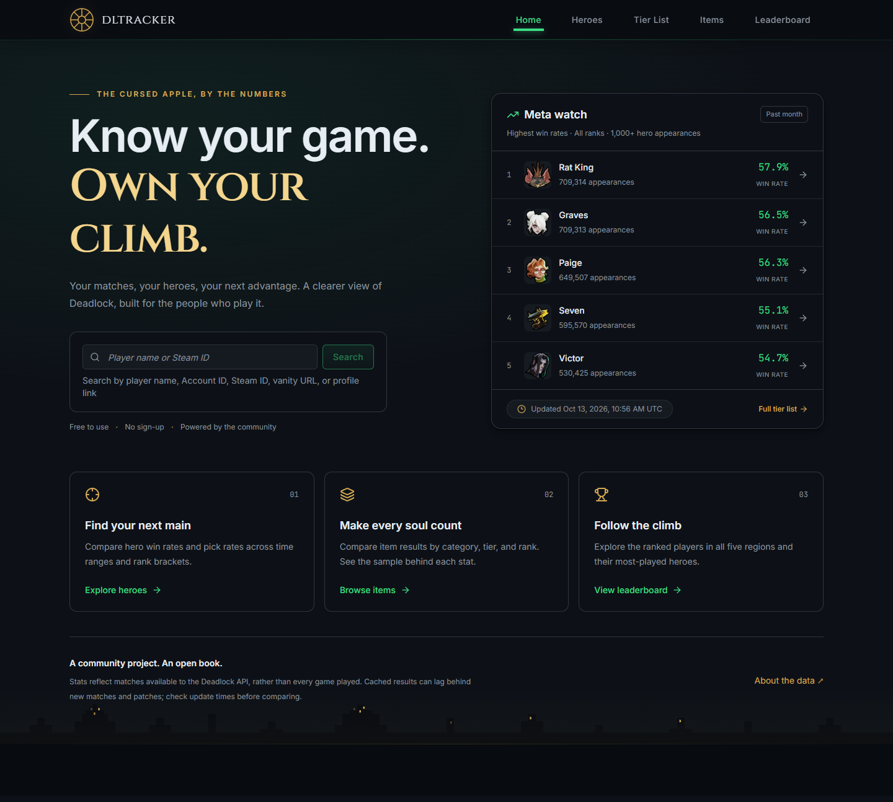
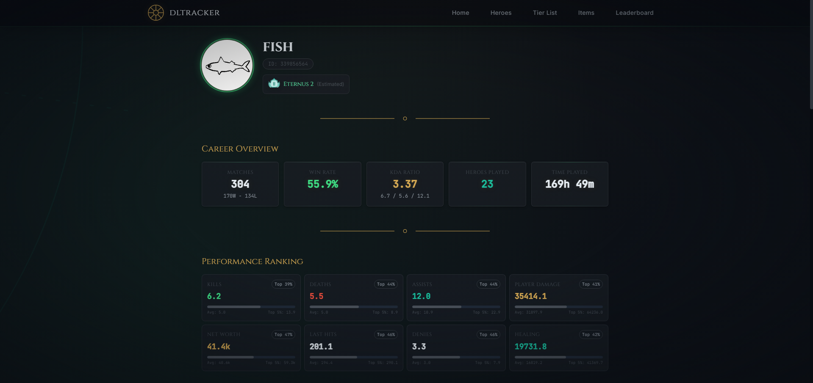
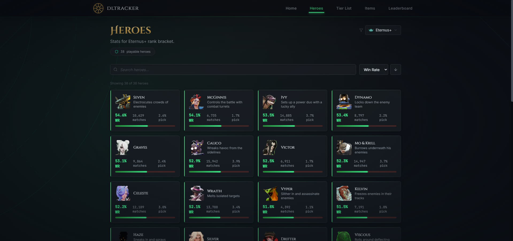
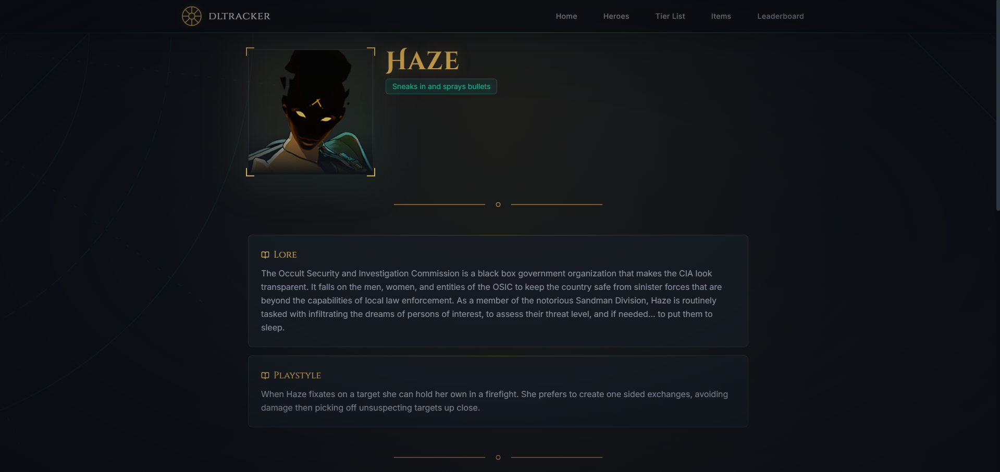
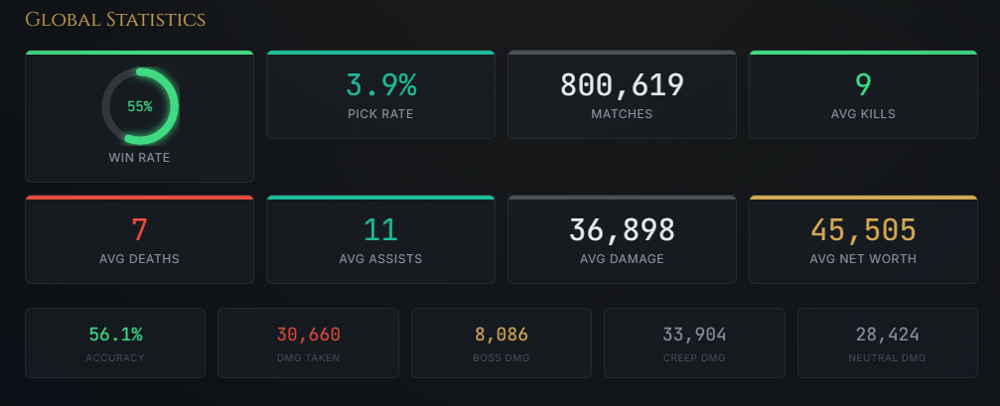
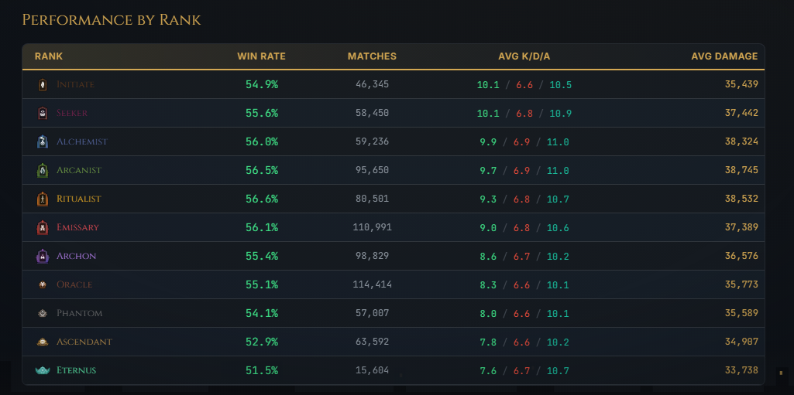
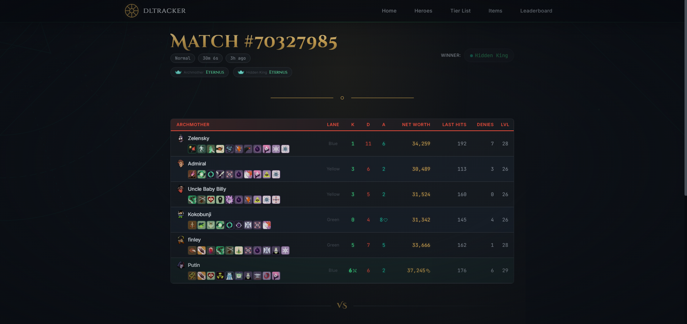
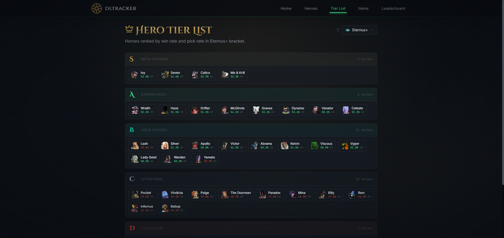
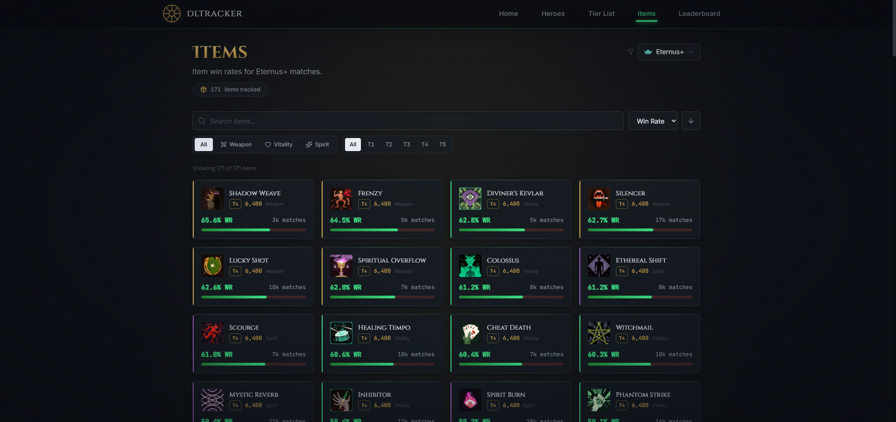
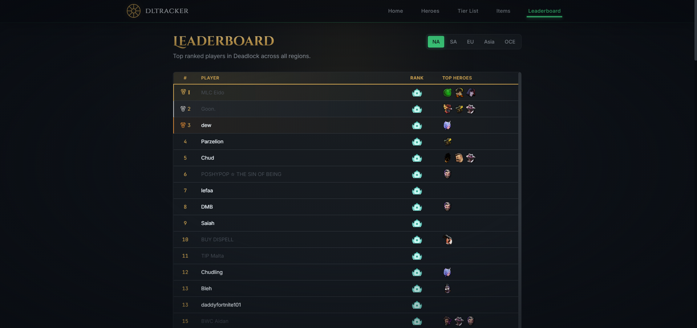

<div align="center">

# DLTRACKER

**A living record of souls and matches from the Cursed Apple.**

Track players, analyze heroes, and explore match history in Deadlock. The homepage combines player search with a monthly meta snapshot, while the dark amber and green interface keeps the game's occult atmosphere.

**[dltracker.app](https://dltracker.app)**

Hosting paused? See the [free-hosting restoration guide](docs/free-hosting.md) for the CPU/ISR fixes, deployment checks, and remaining free-tier limits. Screenshots below show the earlier interface.



</div>

---

## Features

### Player Profiles

Search any player by player name, Steam ID, vanity URL, or profile link. View career stats, estimated rank, performance percentiles, top heroes, and resilient paginated match history.



### Heroes

Browse the current playable hero roster with win rates, pick rates, and match counts. Filter by time range and rank bracket. Sort by any stat.



### Hero Detail

Deep-dive into any hero with lore, playstyle descriptions, global statistics, and a full performance breakdown by rank tier.

<details>
<summary>View hero detail screenshots</summary>





</details>

### Match Detail

Full team scoreboards with K/D/A, net worth, last hits, item builds, and cross-linked players and heroes.



### Tier List

Heroes ranked into S/A/B/C/D tiers by win rate and pick rate. Filter by time range and rank bracket to see how the meta shifts.



### Items

Shop items tracked with win rates and match counts. Filter by time range, rank bracket, type (Weapon/Vitality/Spirit), and tier.

<details>
<summary>View items screenshot</summary>



</details>

### Leaderboard

Regional rankings across NA, SA, EU, Asia, and Oceania with rank badges, top heroes, top-50 initial loading, and safely enriched player profile links.

<details>
<summary>View leaderboard screenshot</summary>



</details>

---

## Architecture

### Tech Stack

| Layer | Technology |
|-------|-----------|
| Framework | Next.js 16 (App Router, ISR, Suspense streaming) |
| Language | TypeScript (strict mode) |
| Styling | Tailwind CSS 4 (CSS-first config) |
| Animations | Framer Motion |
| Data storage | Compact Upstash snapshots; no SQL database required |
| Cache / Rate Limiting | Upstash Redis |
| Monitoring | Sentry, Pino (structured JSON logging), Vercel Analytics |
| Validation | Zod |
| Testing | Vitest, React Testing Library, jsdom, Playwright |
| CI/CD | GitHub Actions (lint, typecheck, unit tests, security audit) |
| Data Sources | [Deadlock Community API](https://deadlock-api.com), including cached Steam profiles; optional Steam Web API |

### Key Engineering Decisions

- **ISR + `generateStaticParams`** for hero and match pages: pre-renders the available hero roster at build time and caches match pages on first visit. Large raw match responses are not also persisted in Next's fetch cache.
- **Shared static player shell**: numeric player URLs rewrite to one CDN page; player JSON uses a stable, cached API URL. Explicit refreshes bypass the CDN. Unknown numeric profiles show an in-page message with an API 404.
- **Bounded public dataset caching**: compact analytics use hourly time buckets and a finite set of time ranges. Redis REST commands are never persisted in Next's fetch cache, preserving lock and TTL behavior.
- **Navigation and accessibility**: route prefetch is disabled, with a skip link, readable muted text, UTC update times, mobile menu state, and reduced-motion preferences.
- **Suspense streaming** on data-heavy pages: the page shell renders instantly while API data streams in, improving perceived load time.
- **Multi-signal account resolution** on the leaderboard: ambiguous leaderboard account IDs are resolved with Steam profile and hero-pattern signals only for the visible page.
- **Cache resilience for expensive paths**: shared read-through cache helpers serve stale snapshots on rebuild failure and avoid duplicate rebuilds with short Redis locks.
- **Rank estimation from match badges**: player ranks are estimated by averaging team badge values from recent matches and mapping them to rank tiers.
- **Runtime API guards**: critical Steam and Deadlock payloads are validated with Zod before cached data reaches rendering code.
- **Reusable client snapshot hooks**: player and leaderboard views keep fetch state, abort handling, refresh behavior, and loading transitions in focused hooks with unit coverage.
- **Custom design system**: "Occult Noir Ascended" theme with glassmorphism panels, animated conic-gradient borders, per-page atmospheric gradients, and glowing stat bars.

### Local Verification

```bash
npm run lint
npx tsc --noEmit
npm run test:unit
npm run test:e2e
npm audit --audit-level=high
npm run build
```

GitHub Actions runs lint, typecheck, unit tests, and high-severity audit on pull requests. Vercel deploy previews validate production builds.

### Data Flow

```
User searches player name
  → Steam Vanity URL API (resolve name → Steam64 ID)
  → Steam Player Summary API (name, avatar)
  → Convert Steam64 → Account ID (subtract offset)
  → Deadlock API (hero stats, match history, performance metrics)
  → Rank estimation (badge averaging from recent matches)
  → Shared static player shell + CDN-cached player API + compact Redis snapshot
```

---

## Design

The theme uses a dark palette with soul-green (`#3DDC84`) and amber accents. The homepage favors readable typography, direct navigation, and sample sizes over entrance effects. Existing detail views retain their atmospheric styling, with global contrast and motion improvements.

---

## Support

If you find dltracker useful, consider [supporting on Ko-fi](https://ko-fi.com/trazen).

## Disclaimer

This project is not affiliated with Valve Corporation. Deadlock and all related properties are trademarks of Valve Corporation.
